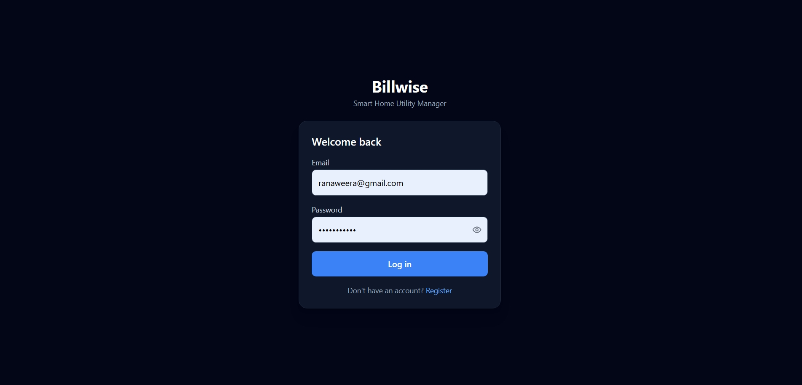
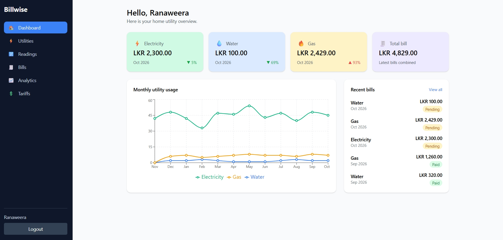
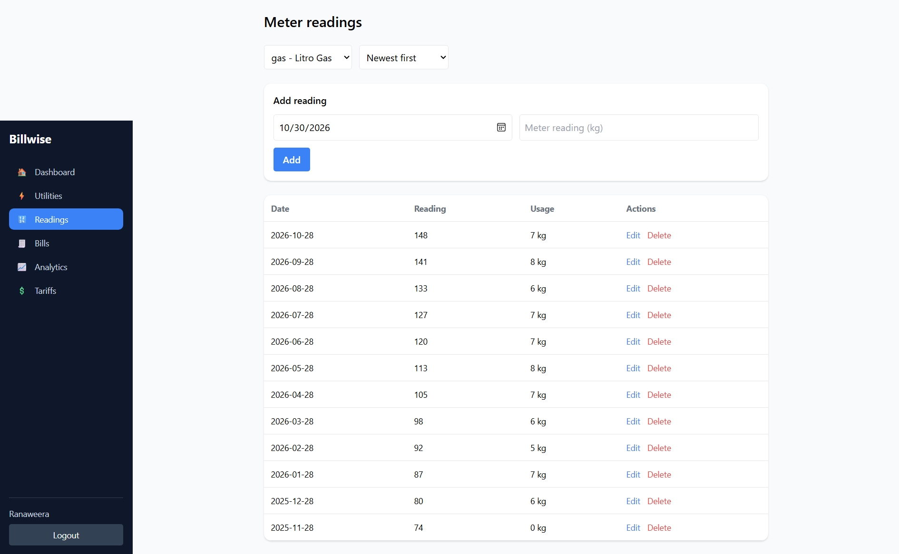
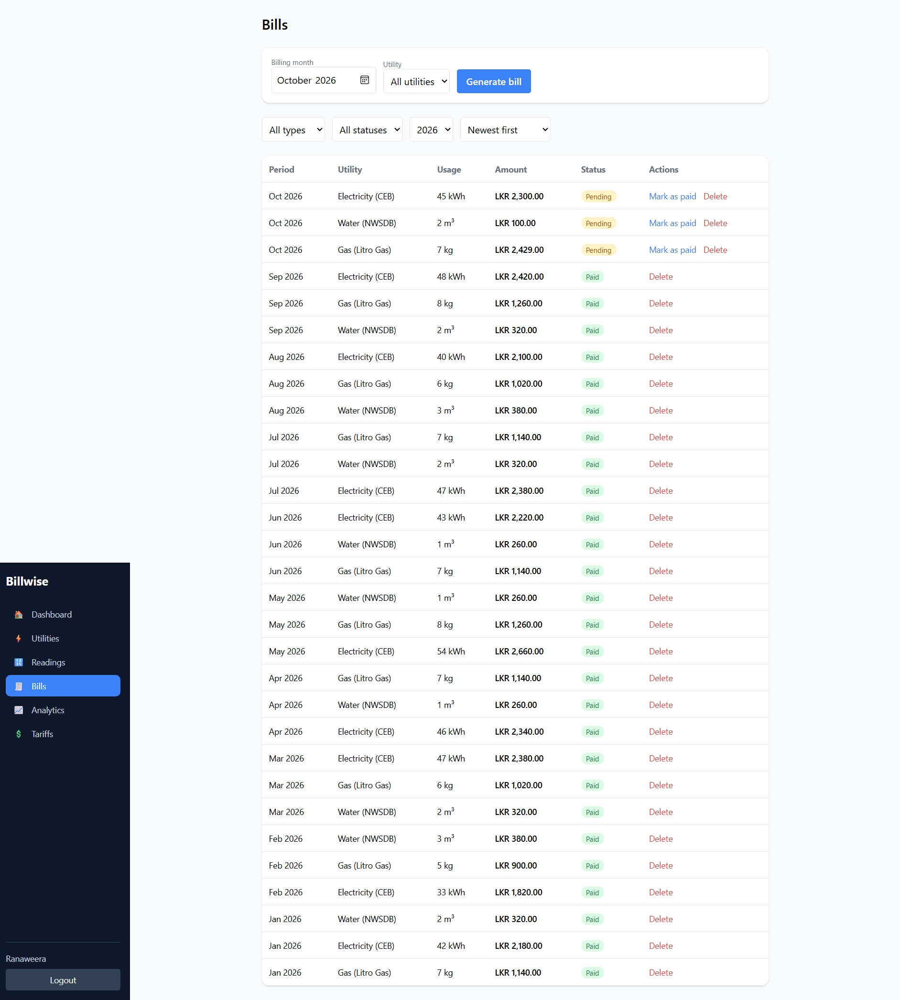
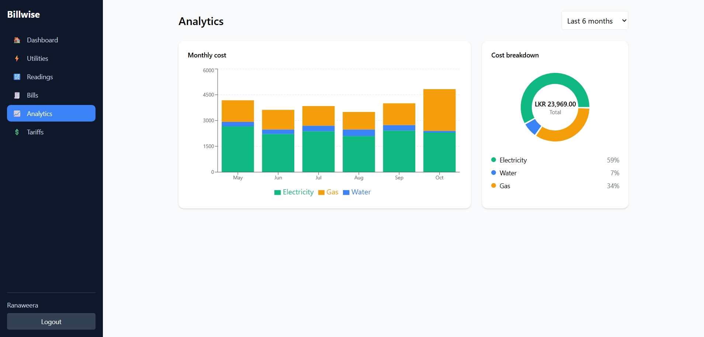
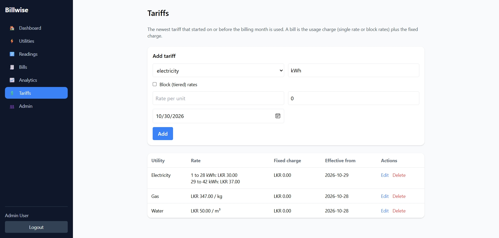
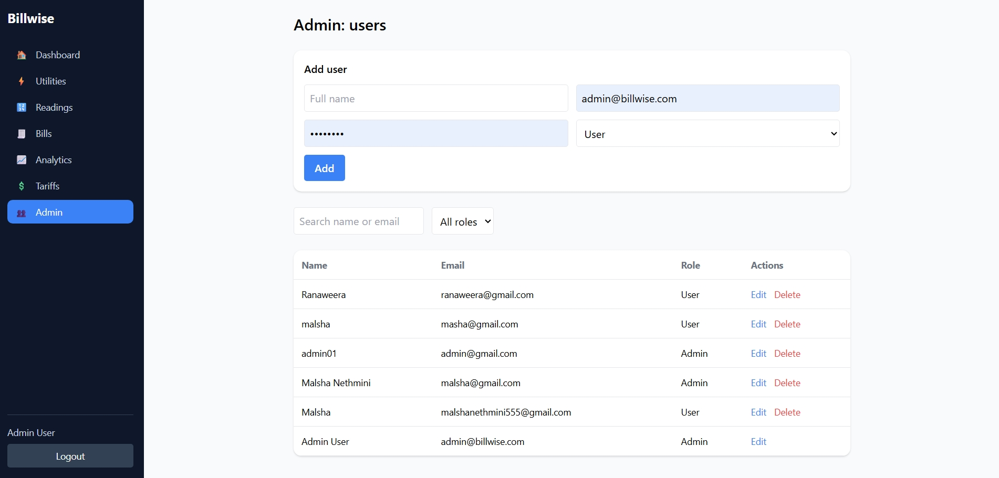

# Billwise-v2

A web application that helps families track their electricity, water and gas bills.
Users record meter readings each month, and the app calculates usage and creates bills
automatically from tariff rates.

Built with React, Node.js, Express and MongoDB.

## Features

- Register, login and logout (JWT stored in an httpOnly cookie)
- Utilities: add, view, edit, delete, with search, filter and sort
- Meter readings: add, view, edit, delete. Usage is calculated automatically
- Bills: generate by month, mark as paid, filter, sort, delete
- Tariffs: admin can add, edit and delete rates. The newest rate is used for each bill
- Dashboard with summary cards, usage chart and recent bills
- Analytics with a monthly cost chart and a cost breakdown
- Admin panel to manage users
- Input validation on the client and the server

## Tech stack

| Part | Technology |
|---|---|
| Frontend | React, Vite, Tailwind CSS, React Router, Axios, Recharts |
| Backend | Node.js, Express, Mongoose |
| Database | MongoDB (Atlas) |
| Auth | JWT in an httpOnly cookie, bcrypt password hashing |

## Setup

You need Node.js 18 or newer and a MongoDB database (a free Atlas cluster works).

### 1. Clone

~~~bash
git clone https://github.com/Malsha23/billwise-v2.git
cd billwise-v2
~~~

### 2. Backend

~~~bash
cd backend
npm install
copy .env.example .env
~~~

Open `.env` and set `MONGO_URI` and `JWT_SECRET`. Then:

~~~bash
npm run dev
~~~

You should see `MongoDB connected` and `API running on http://localhost:5000`.

### 3. Frontend

In a second terminal:

~~~bash
cd frontend
npm install
npm run dev
~~~

Open http://localhost:5173

### 4. Make an admin

Register a normal account first. Then, in MongoDB Atlas (Browse Collections),
open the `users` collection and change that user's `role` from `user` to `admin`.

## How billing works

1. Add a utility and enter meter readings. Usage = this reading minus the previous reading.
2. On the Bills page, choose a month and click Generate bill.
3. Amount = usage × rate per unit + fixed charge, using the newest tariff that started on or before that month.
   If no tariff exists, built-in default rates are used.

## Project structure

~~~
backend/
  src/
    models/       Mongoose models
    routes/       API routes
    middleware/   auth and error handling
    services/     bill calculation
    utils/        validation helpers
frontend/
  src/
    pages/        one file per screen
    lib/          API client and formatting helpers
docs/
  ERD.md          database design
  screenshots/    UI screenshots
~~~

## Database design

See [docs/ERD.md](docs/ERD.md).

## Screenshots

| Login | Dashboard |
|---|---|
|  |  |

| Utilities | Meter readings |
|---|---|
|  |  |

| Bills | Analytics |
|---|---|
|  |  |

| Tariffs | Admin |
|---|---|
|  |  |

| Admin |
|---|
|  |