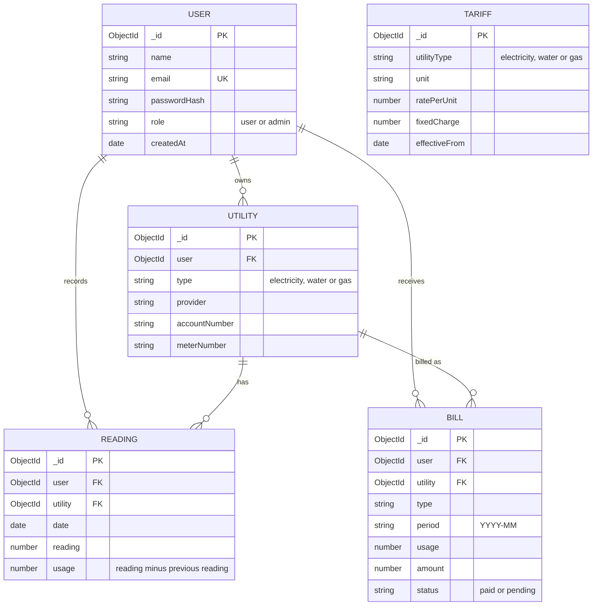

# Database design (ERD)

## Notes

- A user owns many utilities. Each utility has many readings and many bills.
- `BILL` has a unique index on (`utility`, `period`), so a utility can have only one bill per month.
- `TARIFF` is not linked by a foreign key. A bill uses the newest tariff whose `utilityType` matches and whose `effectiveFrom` is on or before the billing month.
- Deleting a utility also deletes its readings and bills. Deleting a user deletes all of their data.